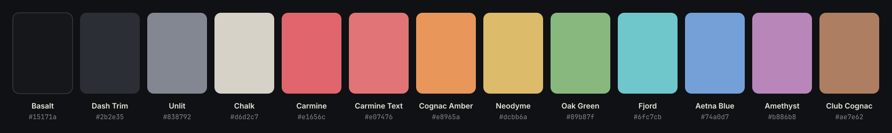
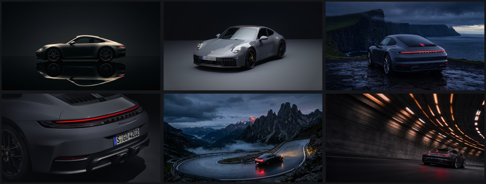

# Carrera

A dark [Omarchy](https://omarchy.org) theme inspired by the Porsche 911 Heritage Cockpit on a night drive:
Basalt Alcantara surfaces, warm Chalk (`Kreide`) dial numerals, brushed GT Silver trim, and a single
disciplined spark of Carmine Red for the rev needle and smoked tail-light horizon.

Built for 10+ hour daily coding sessions: perceptually uniform OKLCH syntax hues, glare-free contrast
tuned to the APCA ergonomic band, and restrained chroma that eliminates red/blue chromostereopsis.


## Install

```bash
omarchy theme install https://github.com/AryanHamedani/omarchy-carrera-theme
```

Or open the menu: **Style → Theme → Install**, and paste the URL.

## Palette



Every colour is drawn from Porsche's Exclusive Manufaktur and Heritage Design palette, calibrated in
OKLCH so no token jumps off the screen. Every readable text role — including comments and accents —
meets at least WCAG AA (4.5:1) on the Basalt canvas, with primary Chalk text sitting at 11.9:1
(APCA Lc -78) to avoid halation.

| Role | Colour | Hex |
|---|---|---|
| Background | Basalt Alcantara | `#15171a` |
| Text | Chalk (`Kreide`) | `#d6d2c7` |
| Accent, focus, cursor | Carmine Red | `#e1656c` |
| Selection | Machined dash trim | `#2b2e35` |
| Comments | Unlit gauge markings | `#838792` |
| red / orange / yellow | Carmine Red, Cognac Amber, Satin Neodyme | `#e07476` `#e8965a` `#dcbb6a` |
| green / cyan / blue | Oak Green Sage, Fjord Glacier, Aetna Blue | `#89b87f` `#6fc7cb` `#74a0d7` |
| magenta / brown | Amethyst Metallic, Club Cognac | `#b886b8` `#ae7e62` |

## Wallpapers



Six night scenes, all keyed on the red tail light. Cycle them with `omarchy theme bg next`.
Four have an intro that plays once when the theme or wallpaper is set, then settles on the
still (turn intros off with `omarchy theme bg intro disable`):

1. Flyline studio: the rim light sweeps along the roofline, tail light first
2. Alpine blue hour: a slow push in out of the dark
3. Air-cooled garage: the overhead tube flickers on
4. Headlight in the rain: a focus pull from soft to sharp
5. Parking deck
6. Coastal light trails

## What's themed

From `colors.toml`, through Omarchy's own templates: terminals (Alacritty, Foot, Ghostty,
Kitty), Neovim, VS Code, Helix, the Omarchy shell and bar, the lock screen, Chromium, tmux,
GNOME apps and more. On top of that, Carrera ships:

- **btop**: graphs that sweep like a tachometer, Oak Green Sage → Satin Neodyme → Carmine Red.
- **Window borders**: a smoked Carmine tail-light gradient on the focused window that melts into dark graphite.
- **Icons**: Yaru Wartybrown Dark (Cognac leather folders).
- **Boot unlock screen**: the Omarchy wordmark in red, via **Style → Unlock** in the Omarchy menu.

## Credits

The wallpapers were generated for this theme with OpenAI's image model (through Codex) and
Google's image model (through Antigravity) from a single art-direction brief, then graded and
upscaled to 2560×1440.

Not affiliated with or endorsed by Porsche AG. Porsche, 911 and Carrera are trademarks of
Porsche AG.

## License

[MIT](LICENSE)
